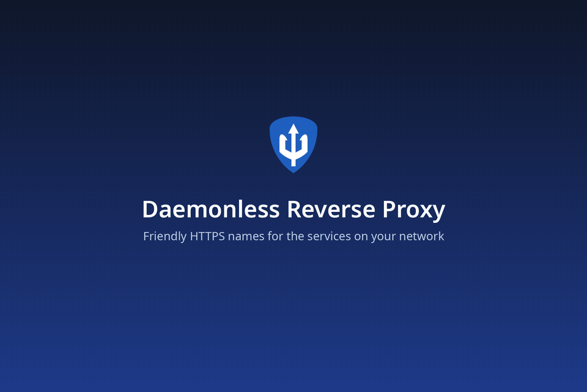

<!--
THIS FILE IS AUTOGENERATED - DO NOT EDIT MANUALLY
Source: dbuild templates
-->

# Daemonless Reverse Proxy

[](https://github.com/daemonless/reverse-proxy/actions)
[](https://github.com/daemonless/reverse-proxy/commits)
[](https://hub.docker.com/r/daemonless/reverse-proxy)

Give every app on your network a real name with HTTPS: radarr.home.lan instead of 192.168.1.20:7878. Set up in a browser, no config files.



Your apps live at addresses like `192.168.1.20:7878`, and every browser
warns that they are "not secure". The reverse proxy gives each one a
name, `radarr.home.lan` or `radarr.example.com`, with a padlock. You
set it up from a web page, step by step, and add a name by pasting the
address you use today. It is [Caddy](https://caddyserver.com) underneath, managed for you.

**What it does**

- **A name and a padlock for every app.** Paste where an app is; the proxy finds out whether it speaks HTTP or HTTPS and checks that it answers.
- **Tells you when an app is down.** Every name is checked once a minute: its last 24 hours and its uptime show on the Names page, 90 days and the outages on its own. A message to ntfy or a webhook when one stops answering, and again when it is back.
- **Three kinds of names, your choice.** *Just for home* (`radarr.home.lan`): free, works without the internet; the proxy is its own certificate authority, limited to your ending, and walks each phone and computer through trusting it once, with a QR code. *A free name* (`radarr.you.duckdns.org`) or *your own domain* (`radarr.example.com`): real certificates from Let's Encrypt, one wildcard for every name, renewed by itself; nothing to install on any device. It picks your DNS provider from the domain (Cloudflare, Route 53, DuckDNS, deSEC, Porkbun, Hetzner, OVH, Gandi, RFC 2136, acme-dns) and tries the token on Let's Encrypt's test service first.
- **Home only, unless you say so.** Every name opens only for devices on your home network. Open one to the internet when you want to; outsiders asking for any other name get nothing back, not even a "not found". On a host with several networks, you pick which are home: the proxy still reaches apps on the others.
- **Short links.** Type `go/radarr` in any browser on your network. `go/` alone lists every name.
- **Walks you through your router.** Setup says exactly which record to add, with steps for OPNsense, pfSense, UniFi, Pi-hole, AdGuard Home and others, and turns green when it works.
- **Says what is wrong, in plain words.** A certificate that fails says why (token rejected, record never appeared, rate limit) and how to fix it. A name nobody set up shows a page saying so, at home.
- **Works with [fjord](https://github.com/daemonless/fjord), and with your app.** Installed from fjord, it pairs by itself: fjord lists your apps that have no name yet, names them in one click, and keeps each name pointing at its app when the app moves to a new address. Any other app can link the same way, through the same API.
- **Scriptable.** A key per app or script manages names and nothing else; there is an OpenAPI reference and a command line inside the container.
- **Easy to keep.** One encrypted backup file holds everything; restore it on a fresh install. Delete a name by mistake and Undo brings it back.

Native FreeBSD (amd64 and arm64). Caddy is built from source; the admin and web UI come from [daemonless/reverse-proxy-src](https://github.com/daemonless/reverse-proxy-src) releases. The web UI runs unprivileged; only Caddy is root, to bind ports 80 and 443.

| | |
|---|---|
| **Port** | 80 |
| **Registry** | `ghcr.io/daemonless/reverse-proxy` |
| **Source** | [https://github.com/daemonless/reverse-proxy](https://github.com/daemonless/reverse-proxy) |
| **Website** | [https://daemonless.io/images/reverse-proxy/](https://daemonless.io/images/reverse-proxy/) |

## Version Tags
| Tag | Description | Best For |
| :--- | :--- | :--- |
| `latest` | **Beta** -- the newest reverse-proxy-src pre-release. For testing; back up /config first. | Most users — recommended. |

## Prerequisites
Before deploying, ensure your host environment is ready. See the [Quick Start Guide](https://daemonless.io/guides/quick-start) for host setup instructions.

## Deployment

### Podman Compose

**Names from container labels.** Containers on this machine with io.daemonless.proxy labels get names here. The proxy reads podman's socket; the web UI never does.

#### Off (default)

Save as `compose.yaml`:

```yaml { data-zip-bundle="reverse-proxy-podman" data-zip-filename="compose.yaml" }
name: reverse-proxy

services:
  reverse-proxy:
    image: ghcr.io/daemonless/reverse-proxy:latest
    container_name: reverse-proxy
    # "always", not "unless-stopped": FreeBSD's podman rc.d only auto-starts
    # containers with restart-policy=always at boot (needs podman_enable=YES).
    restart: always
    # SELinux (Fedora, RHEL): lets the proxy use its folders and podman's
    # socket. Ignored where there is no SELinux.
    security_opt:
      - label=disable

    environment:
      - PUID=1000
      - PGID=1000
      - TZ=UTC
      # - RP_ADMIN_URL=https://192.168.1.5:8443
      # Set by an app that installs the proxy (fjord); empty otherwise.
      - RP_PAIRING_KEY=
      - RP_PAIRING_NAME=fjord
      - RP_PAIRING_ID=
      - RP_SETUP_TOKEN=
      - RP_PAIRING_URL=

    volumes:
      - /path/to/containers/reverse-proxy:/config
      - /path/to/containers/reverse-proxy/data:/data
      # Names from container labels: point RP_PODMAN_DIR at the host's
      # /var/run/podman (the directory). Empty directory: off.
      - ${RP_PODMAN_DIR:-/path/to/containers/reverse-proxy/podman}:/var/run/podman:ro

    ports:
      - 80:80
      - 443:443
      - 8443:8443
```

Then run `podman-compose up -d`.

#### On: the proxy reads podman's socket

**1.** Save as `.env` and fill in what is empty:

```env { data-zip-bundle="reverse-proxy-podman-container_labels-on" data-zip-filename=".env" }
# Names from container labels: On: the proxy reads podman's socket
RP_PODMAN_DIR=/var/run/podman
```

**2.** Save as `compose.yaml`:

```yaml { data-zip-bundle="reverse-proxy-podman-container_labels-on" data-zip-filename="compose.yaml" }
name: reverse-proxy

services:
  reverse-proxy:
    image: ghcr.io/daemonless/reverse-proxy:latest
    container_name: reverse-proxy
    # "always", not "unless-stopped": FreeBSD's podman rc.d only auto-starts
    # containers with restart-policy=always at boot (needs podman_enable=YES).
    restart: always
    # SELinux (Fedora, RHEL): lets the proxy use its folders and podman's
    # socket. Ignored where there is no SELinux.
    security_opt:
      - label=disable

    environment:
      - PUID=1000
      - PGID=1000
      - TZ=UTC
      # - RP_ADMIN_URL=https://192.168.1.5:8443
      # Set by an app that installs the proxy (fjord); empty otherwise.
      - RP_PAIRING_KEY=
      - RP_PAIRING_NAME=fjord
      - RP_PAIRING_ID=
      - RP_SETUP_TOKEN=
      - RP_PAIRING_URL=

    volumes:
      - /path/to/containers/reverse-proxy:/config
      - /path/to/containers/reverse-proxy/data:/data
      # Names from container labels: point RP_PODMAN_DIR at the host's
      # /var/run/podman (the directory). Empty directory: off.
      - ${RP_PODMAN_DIR:-/path/to/containers/reverse-proxy/podman}:/var/run/podman:ro

    ports:
      - 80:80
      - 443:443
      - 8443:8443
```

Then run `podman-compose up -d`.

### AppJail Director

#### Off (default)

**.env**:

```
# .env

DIRECTOR_PROJECT=reverse-proxy
PUID=1000
PGID=1000
TZ=UTC
RP_PAIRING_KEY=<RP_PAIRING_KEY>
RP_PAIRING_NAME=fjord
RP_PAIRING_ID=
RP_SETUP_TOKEN=<RP_SETUP_TOKEN>
RP_PAIRING_URL=
```

**appjail-director.yml**:

```yaml
# appjail-director.yml

options:
  - virtualnet: ':<random> default'
  - nat:
services:
  reverse-proxy:
    name: reverse_proxy
    options:
      - container: 'args:--pull'
      - expose: '80:80 proto:tcp'
      - expose: '443:443 proto:tcp'
      - expose: '8443:8443 proto:tcp'
    oci:
      user: root
      environment:
        - PUID: !ENV '${PUID}'
        - PGID: !ENV '${PGID}'
        - TZ: !ENV '${TZ}'
        - RP_PAIRING_KEY: !ENV '${RP_PAIRING_KEY}'
        - RP_PAIRING_NAME: !ENV '${RP_PAIRING_NAME}'
        - RP_PAIRING_ID: !ENV '${RP_PAIRING_ID}'
        - RP_SETUP_TOKEN: !ENV '${RP_SETUP_TOKEN}'
        - RP_PAIRING_URL: !ENV '${RP_PAIRING_URL}'
    volumes:
      - reverse-proxy: /config
      - reverse-proxy_data: /data
      - reverse-proxy_podman}: -/path/to/containers/reverse-proxy/podman}
volumes:
  reverse-proxy:
    device: '/containers/reverse-proxy'
  reverse-proxy_data:
    device: '/containers/reverse-proxy/data'
  reverse-proxy_podman}:
    device: '/containers/reverse-proxy/podman}'
```

**Makejail**:

```
# Makejail

ARG tag=beta

OPTION container=boot
OPTION overwrite=force
OPTION from=ghcr.io/daemonless/reverse-proxy:${tag}
```

Save the files above, then run `appjail-director up`.

#### On: the proxy reads podman's socket

**.env**:

```
# .env

DIRECTOR_PROJECT=reverse-proxy
PUID=1000
PGID=1000
TZ=UTC
RP_PAIRING_KEY=<RP_PAIRING_KEY>
RP_PAIRING_NAME=fjord
RP_PAIRING_ID=
RP_SETUP_TOKEN=<RP_SETUP_TOKEN>
RP_PAIRING_URL=
RP_PODMAN_DIR=/var/run/podman
```

**appjail-director.yml**:

```yaml
# appjail-director.yml

options:
  - virtualnet: ':<random> default'
  - nat:
services:
  reverse-proxy:
    name: reverse_proxy
    options:
      - container: 'args:--pull'
      - expose: '80:80 proto:tcp'
      - expose: '443:443 proto:tcp'
      - expose: '8443:8443 proto:tcp'
    oci:
      user: root
      environment:
        - PUID: !ENV '${PUID}'
        - PGID: !ENV '${PGID}'
        - TZ: !ENV '${TZ}'
        - RP_PAIRING_KEY: !ENV '${RP_PAIRING_KEY}'
        - RP_PAIRING_NAME: !ENV '${RP_PAIRING_NAME}'
        - RP_PAIRING_ID: !ENV '${RP_PAIRING_ID}'
        - RP_SETUP_TOKEN: !ENV '${RP_SETUP_TOKEN}'
        - RP_PAIRING_URL: !ENV '${RP_PAIRING_URL}'
    volumes:
      - reverse-proxy: /config
      - reverse-proxy_data: /data
      - reverse-proxy_podman}: -/path/to/containers/reverse-proxy/podman}
volumes:
  reverse-proxy:
    device: '/containers/reverse-proxy'
  reverse-proxy_data:
    device: '/containers/reverse-proxy/data'
  reverse-proxy_podman}:
    device: '/containers/reverse-proxy/podman}'
```

**Makejail**:

```
# Makejail

ARG tag=beta

OPTION container=boot
OPTION overwrite=force
OPTION from=ghcr.io/daemonless/reverse-proxy:${tag}
```

Save the files above, then run `appjail-director up`.
Open `http://<server>:80` from another machine (the server's own browser can't use a published port).

## Parameters

### Environment Variables

| Variable | Default | Description |
|----------|---------|-------------|
| `PUID` | `1000` | User ID for the admin process (Caddy stays root to bind 80 and 443) |
| `PGID` | `1000` | Group ID for the admin process |
| `TZ` | `UTC` | Timezone for the container |
| `RP_PAIRING_KEY` | `<RP_PAIRING_KEY>` | Admin only. A key (32+ random characters) an app that installed the proxy, such as fjord, uses to manage hosts; registered once as a connected app |
| `RP_PAIRING_NAME` | `fjord` | Admin only. The connected app's name for RP_PAIRING_KEY. Default: Paired app |
| `RP_PAIRING_ID` | `` | Admin only. The installing app's permanent id, so several of them are told apart. Optional. |
| `RP_SETUP_TOKEN` | `<RP_SETUP_TOKEN>` | Admin only. First-run setup token chosen by the installing app, so it can open setup for you. Default: a new one in the log |
| `RP_PAIRING_URL` | `` | Admin only. Where the installing app is opened, shown as a way back to it. Optional. |
| `RP_ADMIN_URL` | `` | Where you open the admin UI, e.g. https://192.168.1.5:8443. Optional: the proxy remembers the address you sign in at; this makes the first-run link exact before anyone has. |
| `RP_TRUST_PORT` | `` | Host port that reaches the HTTP trust page if you publish it on something other than 80. Optional. |
| `RP_DEBUG` | `` | Set to 1 for Caddy's full info-level log. Off by default so the log stays readable. |

### Volumes

| Path | Description |
|------|-------------|
| `/config` | Admin state and secrets |
| `/data` | Certificates, ACME account and the internal CA |
| `-/path/to/containers/reverse-proxy/podman}` |  |

### Ports

| Port | Protocol | Description |
|------|----------|-------------|
| `80` | TCP | HTTP: trust page and redirects to HTTPS |
| `443` | TCP | HTTPS: your hosts |
| `8443` | TCP | Admin UI (HTTPS) |

### First run

Start the container and read its log: it prints a link like
`https://<this machine>:8443/#token=XXXX-XXXX-XXXX-XXXX`. Open it from
another device on your network (the host itself cannot reach its own
published ports). Setup asks for a password, which networks are home
(only when the proxy is on more than one), how your names should look,
one record on your router, and then helps each device trust the proxy.
Installed from fjord, fjord opens this link for you.

The admin uses a self-issued certificate until setup is done, so the
browser warns once. After setup it lives at `https://proxy.<your ending>`
with a certificate your devices trust. The proxy remembers the address
you sign in at, so `reverse-proxy reset-password` and a later first run
print it; `RP_ADMIN_URL` makes the very first link exact too.

### Names

**Just for home** (`apps.lan`, `home.arpa`, …): the proxy makes its own
root certificate, restricted to that ending, so it can never vouch for
any other site. The Trust page has steps for iPhone and iPad, Android,
Mac, Windows, Linux and FreeBSD, with a QR code for phones. Visitors'
devices see a warning until they trust it too.

**A free name**: pick "A free name from DuckDNS" in setup, sign in at
duckdns.org, add a name, paste its token. Every app gets a name like
`radarr.you.duckdns.org` that every device already trusts.

**Your own domain** (`home.example.com`): setup finds where its DNS is
hosted and asks for a token that can edit its records. The proxy gets
one wildcard certificate from Let's Encrypt for every name under it, so
names never appear in the public certificate logs one by one. Nothing is
reachable from the internet unless you open a name to it.

Per name, for apps that need it: more than one name for the same app;
an app that serves HTTPS itself (its own certificate can be accepted);
and "the service expects its own address", for apps such as UniFi that
refuse a sign-in coming from another name.

### Who can open what

A name is **home network only** unless you open it to the internet.
Home is your private network (`10.x`, `172.16–31.x`, `192.168.x`), plus
anything you add under Settings → Home network, such as a VPN
(`100.64.0.0/10` for Tailscale).

When the container is on several networks (fjord can give it one per
VLAN so it reaches every app), setup and Settings → Home network list
them. Devices on a ticked network can open the proxy and its home-only
names. On an unticked one the proxy does not even answer, and its devices
are never home, whatever your router does; the proxy still reaches the
apps there. The network your browser is on stays ticked, so you cannot
lock yourself out. From the command line:
`reverse-proxy listen 192.168.1.0/24` (or `listen all`); `RP_LISTEN`
sets it in the compose.

### Short links

Type `go/radarr` in a browser to open `radarr.<your ending>`, with any
path after it; `go/` alone lists every name. It takes one more record
on your router (`go` pointing at the proxy); setup and Settings → Short
links walk you through it. The word is yours to change, or turn off.
The first time, type `http://go/radarr` with the `http://`: Safari and
Firefox otherwise search the web for it.

### fjord

Install the proxy from [fjord](https://github.com/daemonless/fjord) and
the two pair by themselves: fjord passes a key and a setup link, and its
Finish setup button opens setup already verified. After that, fjord
lists the apps that have no name yet and names the ones you pick, and
keeps each name pointing at its app when the app's address changes.

### Names from container labels

A container on the same machine can ask for its name with labels, the
way Traefik users expect, without fjord or a key. Turn it on by giving
the proxy podman's socket: the `RP_PODMAN_DIR` line under `volumes`
mounts the host's `/var/run/podman` (the directory, so the socket
survives a `podman_service` restart). In fjord it is the "Name
containers by their labels" switch. The proxy's root unit reads the
socket; the web UI never does. `:ro` does not limit a socket: whoever
holds it can run podman, so it goes only to a proxy you trust with that.
Settings can turn names from labels off while the socket is mounted.

| Label | Means |
|---|---|
| `io.daemonless.proxy=true` | Name it after the container (`radarr` becomes `radarr.<your ending>`). Enough for a daemonless image: the port is the image's own. |
| `io.daemonless.proxy.name=movies` | A different name. |
| `io.daemonless.proxy.port=7878` | The port, when the image declares none or several. |
| `io.daemonless.proxy.names=films,cinema` | More names for the same container. |
| `io.daemonless.proxy.public=true` | Open it to the internet (with a public ending). |
| `io.daemonless.proxy.https=true` | The container itself speaks HTTPS; its own certificate is accepted. |
| `io.daemonless.proxy.own-origin=true` | The service expects its own address in Origin and Referer (UniFi). |

The proxy reaches the container on a network they share (the default
`podman` bridge: no port needs publishing), else through a published
port on the host, and says which on the Names page. The labels own the
name, port and access, shown read-only; trusted networks, own address,
the icon and the uptime check are edited in the proxy and survive a
`podman-compose up`. A stopped or removed container (fjord's Stop and
`compose down` remove it) keeps its name for 7 days and shows as down;
a recreated one (new address, or a new name in its labels) is followed.
After 7 days gone the name goes, restorably for a day. A label the
proxy cannot honor, a name another container or a hand-made name
already has, or a container it cannot reach is listed on the Names
page with the reason, never guessed at. Settings → Connected apps shows
whether podman is being read.

### Your own app

An app that manages services, like a jail or VM manager, can do what
fjord does. It gets a key one of three ways: the person presses "Link an
app…" under Settings → Connected apps and pastes the link into the app,
which redeems it at `POST /api/v1/pair`; the app installs the proxy with
`RP_PAIRING_KEY` set; or the person makes a key by hand. Then it says who
it is (`PUT /api/v1/me`), gives each service a name with a `ref` like
`<app>:<its id>:<service>` so a retry never makes two, and moves the name
when the service's address changes. Connected apps shows each app and how
many names came from it. The steps are at the top of the API reference.

### Scripts and other apps

Anything that can make an HTTPS request can manage names. Make a key
under Settings → Connected apps (or hand one to the proxy at install as
`RP_PAIRING_KEY`) and send it as a bearer token; a key manages names and
nothing else. The reference is the proxy's own
`https://<proxy>:8443/api/v1/openapi.json`.

```sh
curl -sS https://192.168.1.5:8443/api/v1/hosts \
  -H "Authorization: Bearer rp_..." \
  -d '{"name":"radarr","target":{"address":"192.168.1.20","port":7878},"access":"home"}'
```

Inside the container the same works from the command line, no key needed:

```sh
podman exec reverse-proxy reverse-proxy hosts
podman exec reverse-proxy reverse-proxy hosts add radarr 192.168.1.20:7878
podman exec reverse-proxy reverse-proxy hosts remove radarr
```

### Operations

- **Forgot the password:** `podman exec reverse-proxy reverse-proxy reset-password` prints a new setup link.
- **Backup:** Settings → Backup downloads one passphrase-encrypted file (names, settings, password, root certificate, DNS token). Restore it from the welcome screen of a fresh install.
- **Keep `/data`:** it holds the certificates Caddy issued. Losing `/config` loses the root certificate and the DNS token, and every device would have to trust the proxy again; a backup avoids that.
- **Certificate trouble:** the Names page shows a banner while a certificate is being obtained or when it failed, with the reason in plain words. Change the token under Settings → Ending and certificates.
- **Non-default HTTP port:** if you publish the trust page on something other than 80, set `RP_TRUST_PORT` so the Trust page's commands and QR code use it.

### How it works

One container, two programs. Caddy runs as root so it can bind ports 80
and 443; the admin (the web UI and API) runs as `bsd` (`PUID`/`PGID`).
They talk over unix sockets inside the container. The admin keeps one
state file and writes Caddy's whole configuration from it: nothing is
hand-edited, and a change Caddy refuses leaves the running one in place.


**Architectures:** amd64, aarch64
**User:** `root` — the service process stays root by design, not dropped to `bsd`
**Base:** FreeBSD 15.1

---

Need help? Join our [Discord](https://discord.gg/Kb9tkhecZT) community.